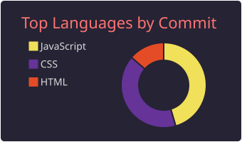

<!-- ===================== APRESENTAÇÃO ===================== -->
<h1 align="center">Olá, eu sou o Ryan Moreira 👋</h1>

  

<h3 align="center">Desenvolvedor Full-Stack | Estudante de Engenharia de Software | Explorando IA Generativa</h3>

  
  

<!-- ===================== GITHUB STATS ===================== -->

  
  

---

<!-- ===================== SOBRE MIM ===================== -->
## 🧑‍💻 Sobre mim

Sou desenvolvedor full-stack com mais de 2 anos de experiência em projetos web, atualmente na **Itpower Software**, onde trabalho com desenvolvimento back-end, integração de APIs e bancos de dados para clientes do setor de seguros.

- 🎓 Cursando **Engenharia de Software** na **Universidade Cruzeiro do Sul**
- 🤖 Estudando **Soluções de Inteligência Artificial Generativa utilizando serviços da AWS**
- 🌱 No momento, focado em aprender a construir aplicações com **LLMs e agentes de IA**
- 🤝 Aberto a colaborar em projetos de **desenvolvimento web e IA**
- 📍 Barueri, São Paulo

---

## 📊 Contribuições

  

  

<!-- ===================== TECNOLOGIAS ===================== -->
## 🛠️ Tecnologias

  

  
  
  
  

---

<!-- ===================== EXPERIÊNCIA ===================== -->
## 💼 Experiência

**Desenvolvedor de Sistemas** · Itpower Software e Ltda. · *2025 – Atual*

- Desenvolvimento back-end com ColdFusion, JavaScript e SQL Server
- Criação e testes de APIs com Postman
- Atendimento a clientes do setor de seguros (SulAmérica)
- Rotina ágil com reuniões diárias e contato direto com clientes

---

<!-- ===================== RODAPÉ ===================== -->

📫 Vamos conversar? Me chame no <a href="https://www.linkedin.com/in/ssilva-ryan/">LinkedIn</a> ou por <a href="mailto:moreiraryan803@gmail.com">e-mail</a>!

