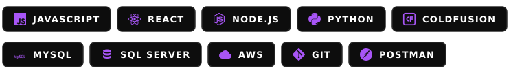

<!-- ===================== BANNER ===================== -->

  

<!-- ===================== APRESENTAÇÃO ===================== -->

  

  
  
  
  

---

<!-- ===================== PAC-MAN ===================== -->

  

---

<!-- ===================== SOBRE MIM ===================== -->

  

<!-- ===================== FOCO ATUAL ===================== -->
##  Foco atual

|  Trabalhando em |  Aprendendo |  Pode me perguntar sobre |
|:---:|:---:|:---:|
| Sistemas web e APIs na Itpower | IA Generativa, LLMs e agentes com AWS | Back-end, APIs REST e bancos de dados |

---

<!-- ===================== TECNOLOGIAS ===================== -->
## Tecnologias

  

---

<!-- ===================== EXPERIÊNCIA ===================== -->
##  Experiência

**Desenvolvedor de Sistemas** · Itpower Software e Ltda. · *2025 – Atual*

- Desenvolvimento back-end com ColdFusion, JavaScript e SQL Server
- Criação e testes de APIs com Postman
- Atendimento a clientes do setor de seguros (SulAmérica)
- Rotina ágil com reuniões diárias e contato direto com clientes

---

<!-- ===================== CONTRIBUIÇÕES ===================== -->
##  Contribuições

  

  

---

<!-- ===================== RODAPÉ ===================== -->

📫 Vamos conversar? Me chame no <a href="https://www.linkedin.com/in/ssilva-ryan/">LinkedIn</a> ou por <a href="mailto:moreiraryan803@gmail.com">e-mail</a>!

